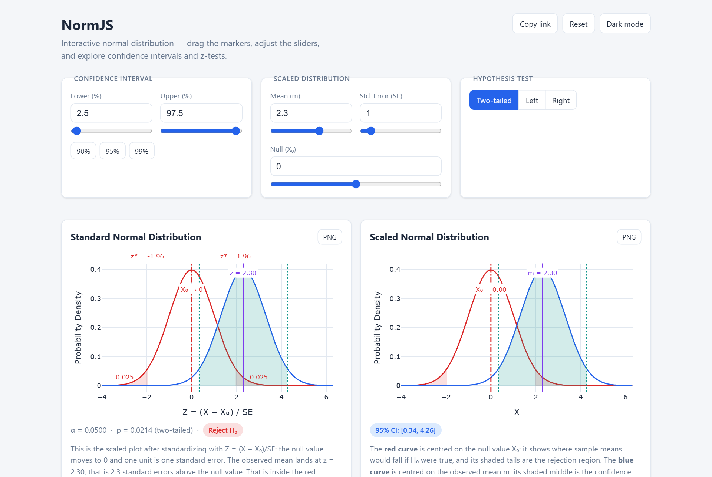

# NormJS — Documentation

NormJS is an interactive visualization of the normal distribution for teaching
and exploring confidence intervals and z-based hypothesis tests. It runs
entirely in the browser with no server or build step.

Live: https://buddyledger.github.io/NormJS/normjs.html

## Controls

Each numeric field has a slider beneath it; the two stay in sync.

| Group | Field | Meaning | Default |
|-------|-------|---------|---------|
| Confidence Interval | Lower (%) | Lower percentile of the interval | 2.5 |
| Confidence Interval | Upper (%) | Upper percentile of the interval | 97.5 |
| Confidence Interval | 90% / 95% / 99% | Set a central interval of that level | — |
| Scaled Distribution | Mean (m) | Centre of the scaled normal | 0 |
| Scaled Distribution | Std. Error (SE) | Spread of the scaled normal (must be > 0) | 1 |
| Scaled Distribution | Null (X₀) | Value being tested against | 0 |
| Hypothesis Test | Two-tailed / Left / Right | Direction of the alternative hypothesis | Two-tailed |
| Z-table | Minimum Z / Maximum Z | Range of the cumulative z-table | -3 / 3 |

The sliders cover a limited range (for example −10 to 10 for the mean); type
into the field to go beyond it.

Inputs are validated as you type. Invalid combinations (non-numeric entries,
percentages outside 0–100, lower ≥ upper, SE ≤ 0, min Z ≥ max Z) show a message
under the controls, and the last valid view stays on screen.

### Dragging markers

The vertical markers on both plots can be dragged. Dragging an interval bound
changes the lower or upper percentile, dragging the red null marker changes X₀,
and dragging the purple marker changes the mean.

### Toolbar

- **Copy link** copies the current address, which encodes every input (see
  [Shareable links](#shareable-links)).
- **Reset** restores the defaults.
- **Dark mode** switches the theme. The choice is remembered in the browser.

## What it shows

### The two curves

Both plots show the same two curves. They have the same width, because they
share one SE, and differ only in where they are centred.

- The **null curve** (red) is centred on the null value X₀. It shows where
  sample means would fall if H₀ were true. Its shaded tails are the rejection
  region, with total area α.
- The **interval curve** (blue) is centred on the observed mean m. Its shaded
  middle is the confidence interval.

Two vertical markers carry the test: a red dash-dot line at the null value and
a solid purple line at the observed mean. **H₀ is rejected exactly when the
purple line falls in the red shading.** For a two-tailed test with a central
interval that is the same as the null value falling outside the interval,
which is why the test and the interval always agree.

Each plot has a legend under it naming the lines and shaded areas.

### Scaled Normal panel

The picture in original units: the null curve N(X₀, SE), the interval curve
N(m, SE), the null value X₀ and the observed mean m. Below the plot are the
interval bounds, for example "95% CI: [0.34, 4.26]".

A grey dashed curve shows the standard normal N(0, 1) for comparison, and the
axis widens to include it. Changing the mean slides the blue curve away from
it; changing the SE makes both curves wider and lower, or narrower and taller.
A sentence under the plot says the same in words ("shifted right by 2.3 and
1.5× as wide and 0.67× as tall"). The reference curve is left out, and the
sentence says so, when the curves could not all be read on one axis (for
example m = 100, SE = 15).

### Standard Normal panel

The same picture after standardizing with **Z = (X − X₀)/SE**. The null curve
becomes the standard normal N(0, 1), the null value moves to 0, and one unit on
the axis is one standard error. The observed mean lands at the test statistic

    z = (m − X₀) / SE

and the interval curve is centred there. The critical values (`z*`) are
labelled at the edges of the rejection regions, and each region is labelled
with its area. Two-tailed regions are always symmetric (α/2 in each tail), even
if the interval percentiles are not.

Because SE is used (not a sample standard deviation with degrees of freedom),
the statistic is a **z-statistic**, not a t-statistic.

Below the plot are α, the p-value and the verdict ("Reject H₀" or "Fail to
reject H₀"), and a sentence reading the plot with the current numbers.

### Equations

Each panel has a collapsible "Equations" section. The standard panel shows the
null curve's density, the standardizing formula and the test statistic with
the current values substituted in; the scaled panel shows the densities of the
null and interval curves.

### Reading this test

A written walkthrough of the current test: the hypotheses, the test statistic,
the significance level, the p-value and the decision. Each step is also
interpreted: how many standard errors the mean is from the null value, what
the p-value means as a share of samples, and that failing to reject H₀ does
not show H₀ is true. For a two-tailed test with a central interval (such as
2.5–97.5) a last step shows that the interval gives the same answer: X₀ outside
the interval means reject.

### Cumulative z-table

A standard normal CDF table over the chosen Z range, laid out like a printed
z-table (tenths down the rows, hundredths across the columns). Values outside
the chosen range are left blank so the columns stay aligned. Cells matching
the interval's percentile z-scores (for example ±1.96) or the test statistic z
are highlighted. The header row stays in view while
scrolling, and the section can be collapsed.

### Sampling Simulator

"Draw 1", "Draw 10", "Draw 100" and "Draw 1000" add that many random values
from N(m, SE).

- **Dots, then bars.** Each draw is a dot stacked in the column where it
  landed (40 columns across m ± 4·SE), so the picture can be counted. Dots
  inside the interval are blue, dots outside it are grey, and the latest draw
  is ringed. Past 400 draws the stacks are drawn as histogram bars instead.
- **Animation.** Runs of up to 10 arrive one at a time: each value appears
  above the plot and then drops into its column. Larger runs arrive in batches
  over about a second. If the browser asks for reduced motion, all draws are
  added at once.
- **Expected line.** The line is the number of draws each column should hold
  on average, n × column width × density, so it grows with the stacks.
- **Statistics.** Under the plot: the number of draws, their mean and standard
  deviation next to m and SE, and how many fell inside the interval ("96 of
  100 (96.0%) inside the 95% interval"). With few draws that share can be far
  from the confidence level; with many it settles near it.

"Clear" empties the plot. Changing the mean or SE also clears it, with a note
saying so, because the draws no longer belong to the curve on screen. The
simulator holds at most 20,000 draws.

## The hypothesis test

- Hypotheses: H₀: m = X₀, against H₁: m ≠ X₀ (two-tailed), m < X₀ (left) or
  m > X₀ (right).
- Significance level: `α = 1 − (upper% − lower%) / 100`. The default 2.5–97.5
  interval gives α = 0.05.
- Critical values: `±Φ⁻¹(1 − α/2)` two-tailed, `Φ⁻¹(α)` left-tailed,
  `Φ⁻¹(1 − α)` right-tailed.
- p-value: `2·(1 − Φ(|z|))` two-tailed, `Φ(z)` left-tailed, `1 − Φ(z)`
  right-tailed.
- Decision: reject H₀ when p < α.

## The math

- Interval curve: `f(x) = 1 / (SE·√(2π)) · exp(−(x − m)² / (2·SE²))`
- Null curve: the same with X₀ in place of m
- Percentile → z-score: `z_p = Φ⁻¹(p)`
- Interval bound: `x = m + z_p·SE`
- Standardizing: `Z = (X − X₀) / SE`
- Test statistic: `z = (m − X₀) / SE`
- Rejection region in original units: beyond `X₀ ± z*·SE` (two-tailed)

## Shareable links

The address bar is updated on every change, so the current address always
reproduces the current view. The state is stored after the `#`:

| Key | Input |
|-----|-------|
| `l`, `u` | Lower and upper percentile |
| `m`, `se`, `x0` | Mean, standard error, null value |
| `mn`, `mx` | Minimum and maximum Z of the table |
| `t` | Test direction: `two`, `left` or `right` |

For example, `normjs.html#m=2&se=1&x0=0&t=right` opens a right-tailed test with
z = 2. Keys that are left out keep their defaults.

The link is read when the page loads. If NormJS is already open in the tab,
reload after pasting a new link.

## Export

- **PNG** on each plot downloads that plot as an image.
- **CSV** on the z-table downloads the table as shown, blanks included.

## Dependencies

Plotly 2.24.1, jStat 1.9.6, and MathJax 3.2.2, vendored under `vendor/` and
loaded from there. No internet connection is needed; the `vendor/` folder must
stay alongside `normjs.html`. See `vendor/README.md` for sources and licences.

If Plotly or jStat fails to load, the page shows a message saying so instead of
a blank view. If only MathJax fails, a warning is shown and everything except
equation rendering still works.

## Development

See the [readme](readme.md#development) for running the tests, the commit and
pull-request workflow, and the repository layout.
