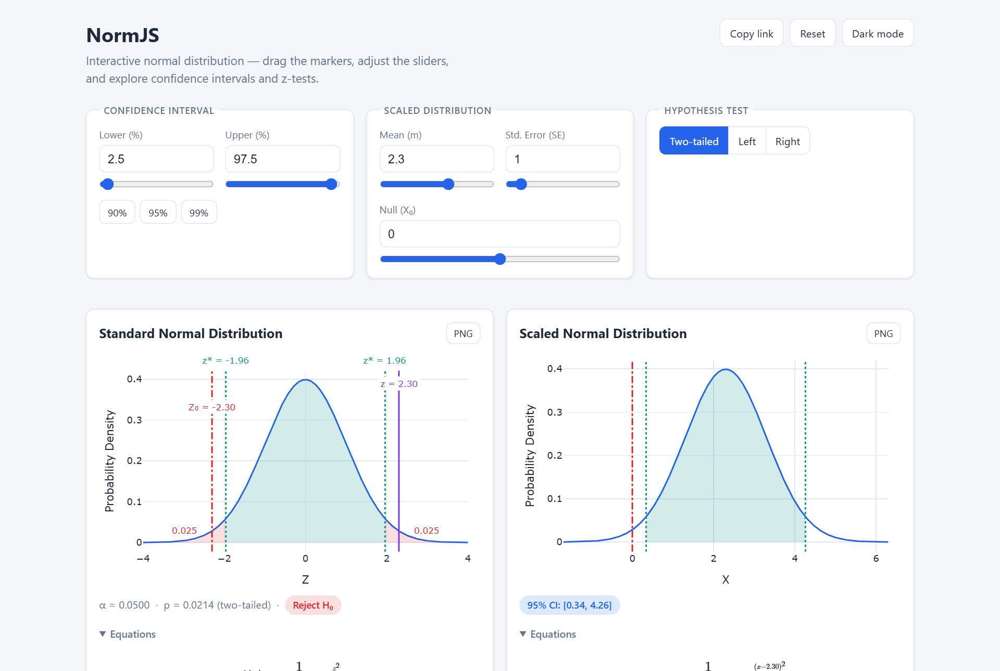

# NormJS

An interactive teaching tool for the normal distribution. It shows a confidence
interval and a z-test side by side, on the standard normal and in the original
units, and updates as you drag the markers or move the sliders.

**[Open NormJS](https://buddyledger.github.io/NormJS/normjs.html)** — it runs
in the browser; there is nothing to install.



## What it does

- **Two linked plots.** The standard normal N(0, 1) and the scaled normal
  N(m, SE) show the same interval, null value and test, so students can see how
  standardizing maps one onto the other.
- **Confidence intervals.** Set the lower and upper percentiles (or pick 90%,
  95% or 99%) and read the bounds in original units, for example
  "95% CI: [0.34, 4.26]".
- **Hypothesis tests.** Choose a two-tailed, left-tailed or right-tailed test.
  The rejection region is shaded, the z statistic is marked, and the p-value
  and the verdict are shown next to α.
- **A step-by-step reading.** "Reading this test" writes out the hypotheses,
  the statistic, α, the p-value and the decision for the current values.
- **A z-table.** A standard normal cumulative table laid out like a printed
  one, with the cells for the current interval and null value highlighted.
- **A sampling simulator.** Draw random values from the scaled normal and watch
  the histogram approach the curve.
- **Sharing and export.** The address bar always holds a link to the current
  state. Plots download as PNG and the table as CSV. There is a dark mode.

[Documentation.md](Documentation.md) describes every control and the math
behind it. [Roadmap.md](Roadmap.md) lists what is planned.

## Run it locally

Download or clone the repository and open `normjs.html` in a browser. No server,
build step or internet connection is needed: Plotly, jStat and MathJax are
included in `vendor/`, which must stay next to `normjs.html`.

## Development

The whole app is one file, `normjs.html` (HTML, CSS and JavaScript). Edit it and
reload the page.

### Tests

A small Playwright suite opens the page from disk and checks the plots,
equations, z-table and test verdicts. It needs Node.js.

```bash
npm ci
```

```bash
npx playwright install chromium
```

```bash
npm test
```

`package.json` exists only for these tests. GitHub Actions runs them on every
pull request and on every push to `main`.

### Commits and pull requests

GitHub Pages publishes the live site from `main`, so whatever lands on `main`
is live a minute or so later. The workflow follows from that:

| Change | Route |
|--------|-------|
| Docs, the roadmap, tests, CI configuration | Commit straight to `main` and push. |
| Anything that touches `normjs.html` or `vendor/` | Branch, open a pull request, wait for the "Smoke tests" check, then squash-merge and delete the branch. |

A change that mixes both goes through a pull request.

- **Branch names:** `fix/…`, `feature/…` or `docs/…`, followed by a short
  description, for example `fix/z-table-alignment`.
- **Commit messages:** a subject line in the imperative ("Add …", "Fix …") that
  says what changed, then a body explaining why when it is not obvious.
  Squash-merged pull requests keep their number in the subject, for example
  "Vendor Plotly, jStat and MathJax locally (#5)".
- **Tests:** when behaviour changes, add or update a test in
  `tests/smoke.spec.js` in the same change.
- **Roadmap:** tick the item in `Roadmap.md` in the same change that
  completes it.

### Repository layout

| Path | Contents |
|------|----------|
| `normjs.html` | The app. |
| `index.html` | Redirects to `normjs.html`. |
| `vendor/` | Plotly 2.24.1, jStat 1.9.6 and MathJax 3.2.2, unmodified. See [vendor/README.md](vendor/README.md). |
| `tests/`, `playwright.config.js`, `package.json` | The smoke tests. |
| `.github/workflows/test.yml` | The CI job that runs them. |
| `docs/` | Images used by the documentation. |
| `Documentation.md`, `Roadmap.md` | User and technical docs; planned work. |
| `CLAUDE.md` | Conventions for AI coding agents working in the repository. |

## Credits

Written by [buddyledger](https://github.com/buddyledger) with AI coding
assistance; current development uses [Claude Code](https://claude.com/claude-code).

NormJS uses [Plotly.js](https://plotly.com/javascript/) and
[jStat](https://github.com/jstat/jstat) (both MIT) and
[MathJax](https://www.mathjax.org/) (Apache 2.0). Their licences are in
`vendor/`. The project itself does not have a licence file yet.
